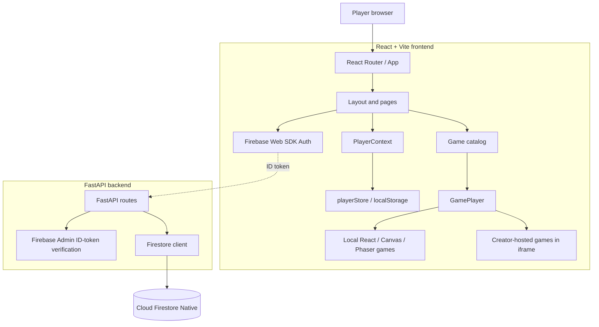
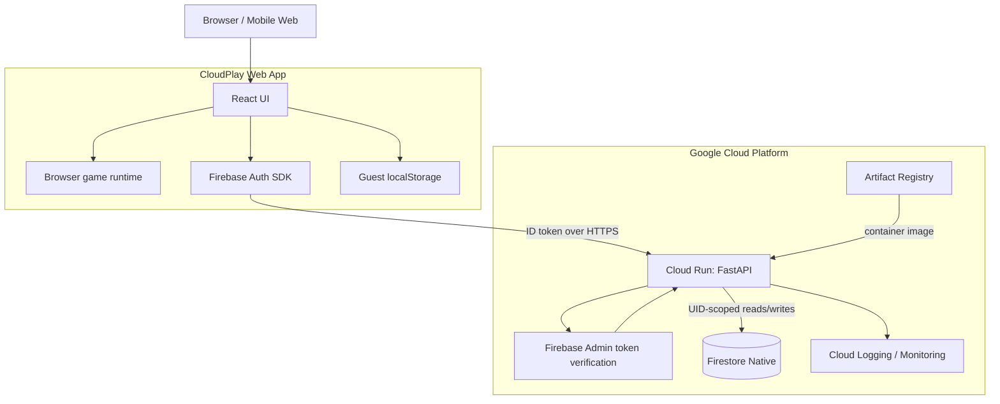
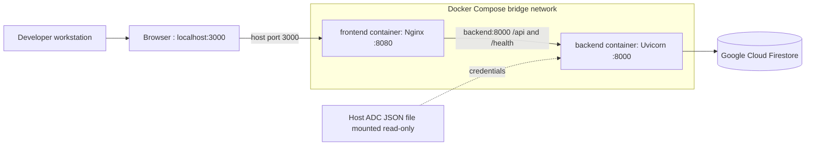
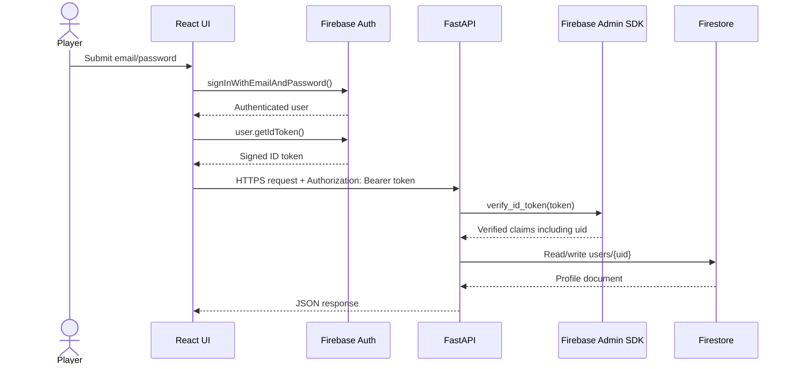
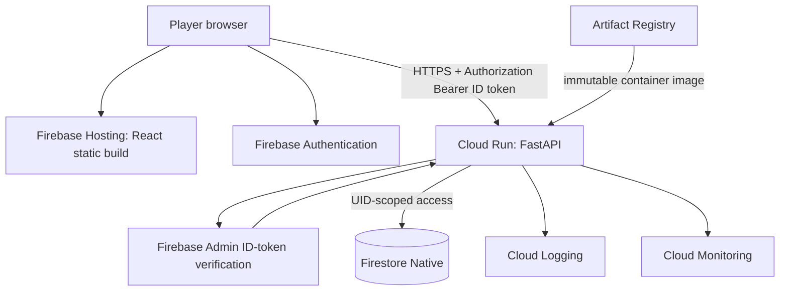
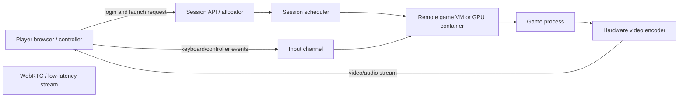

CloudPlay --- Engineering Blueprint & Interview Handbook
Purpose: A source-grounded technical handbook for understanding,
explaining, extending, and presenting CloudPlay in engineering
interviews.

Repository snapshot reviewed: cloud_play(1).zip, reviewed 8
November 2026.

Important status rule: This document distinguishes Implemented
in the uploaded snapshot, Partially implemented, Planned,
and Research option. A roadmap item is not a completed feature.
Re-check the repository before claiming a feature in an interview.

0. How to use this handbook
Read in this order:
1. Product vision and scope.
2. Current architecture and request flows.
3. File-by-file map.
4. Data model and authentication.
5. Docker and GCP deployment design.
6. Cloud gaming / AAA streaming research.
7. Roadmap, risks, and interview questions.
For an interview, explain a design in this order: problem →
requirement → design → data flow → security → scaling → trade-off →
current implementation status.
Status vocabulary
- Implemented: Visible in the uploaded source snapshot.
- Partially implemented: Some code/config exists, but the
  end-to-end workflow is not complete or verified.
- Planned: A proposed next milestone, not current functionality.
- Research option: A technology worth evaluating; not selected or
  deployed.
1. Product vision
1.1 What is CloudPlay?
CloudPlay is an instant-play browser gaming portal. A player opens a
website, discovers games, launches a game without installing a desktop
client, and tracks a platform-level profile containing XP, coins,
favourites, achievements, and play history.

The product has two distinct experiences:
1. Browser-native games: Game logic and rendering execute on the
   player's device using React, Canvas, Web Audio, Phaser,
   Three.js/WebGL, or TypeScript game modules.
2. Creator-hosted embedded games: A game hosted by an external
   creator is displayed inside CloudPlay's player using an iframe. The
   creator still operates the game and its backend.
These are not the same as AAA cloud game streaming. In the current
product, the browser generally executes the game locally or embeds a
remote web game. In true cloud PC/game streaming, the game executes on a
remote GPU machine; video is encoded and streamed to the player, while
keyboard/controller input travels back to the remote machine.
1.2 Product goals
- Instant access from desktop, tablet, and mobile browsers.
- A coherent catalogue and consistent player shell.
- Local-first guest experience; account creation is optional.
- Progression and achievements across CloudPlay's own games.
- Secure account-backed cloud saves as a future completed milestone.
- A low-cost, GCP-centred deployment path.
- A separately researched future path for remote GPU game streaming.
1.3 Non-goals for the current phase
- The current project is not a production AAA streaming service.
- The current local games are not equivalent to commercial AAA
  PC/console titles.
- The repository does not currently contain a production multiplayer
  game server.
- The current Firestore integration is not yet a complete secure
  player-profile service.
- A Firebase sign-in screen alone does not mean backend authorization
  and cloud sync are complete.
1.4 A truthful 30-second interview explanation
"CloudPlay is a browser-based instant gaming portal built with React and
Vite. It has a catalogue, a shared game-player shell, several locally
executed games and selected creator-hosted games embedded in sandboxed
iframes. The current player progression is local-first and stored in
browser localStorage. The backend is FastAPI with Firebase Admin SDK and
Firestore Native integration. I am extending the account flow so
Firebase Authentication ID tokens are verified by FastAPI and player
documents are keyed by the verified Firebase UID. Docker Compose is used
for local multi-container testing. The long-term roadmap separates the
low-cost browser portal from a much more expensive GPU-backed remote
game-streaming service."
2. Current repository audit
2.1 What was actually present in the uploaded ZIP
The archive contained the React/Vite frontend, a small FastAPI backend,
Firebase client configuration, Firebase Admin / Firestore
initialization, Dockerfiles, Nginx configuration, Docker Compose, game
source files, and project reports.
Implemented in the uploaded source snapshot
- React 19 + Vite application and React Router routes.
- Tailwind CSS v4 Vite plugin dependency.
- Firebase client initialization using environment variables.
- Firebase email/password register, login, and logout helpers.
- An authentication page listening to Firebase auth-state changes.
- Local player state held in React Context.
- Player progress persisted to localStorage.
- Game catalogue with local and iframe/embed modes.
- Local game modules including Cyber 2048, Hill Climb, Ludo, Temple
  Run, Asteroid Fury, and Block Puzzle.
- FastAPI application with health, game catalogue, user creation,
  profile-sync, Firestore health, and user-list endpoints.
- Firebase Admin SDK initialization and Firestore client.
- Firebase ID-token verification dependency in
  backend/app/core/security.py.
- Profile-sync endpoint modified to require that dependency and
  compare URL user ID with the verified token UID.
- Frontend syncPlayerProfile helper modified to attach a Firebase ID
  token.
- Frontend and backend Dockerfiles; Nginx reverse proxy; Compose file
  mounting local ADC credentials read-only.
Partially implemented / not yet end-to-end
- Firebase sign-in UI exists, but the uploaded PlayerContext.jsx
  does not listen to Firebase auth state.
- syncPlayerProfile() exists, but the source search in the uploaded
  snapshot found no caller outside api.js.
- The backend sync route expects a Firestore document at
  users/{firebase_uid}, but current registration creates a random
  document ID. Therefore registration and sync are not yet joined into
  one UID-keyed profile lifecycle.
- ProfileSync fields do not cover the complete frontend profile
  schema.
- Current backend user listing is unauthenticated and returns every
  user document.
- Current backend registration is unauthenticated and accepts an
  email/username payload independent of a verified Firebase identity.
- The CORS allowlist includes "*", while credentials are enabled;
  this needs tightening before production.
- Firestore health endpoint writes a test document, so it is not a
  purely read-only health probe.
- The uploaded playerStore.js still contains demo defaults (1250 XP,
  750 coins, etc.). The intended product decision is to change new
  guests to zero progress, but that change is not present in this
  uploaded snapshot.
- Docker Compose uses prebuilt image tags and depends_on; it does
  not itself build images and depends_on does not guarantee the
  backend is ready.
- The frontend Nginx config proxies to Compose service name backend;
  this works only when the frontend container can resolve that service
  on the Compose network. It is not a production Cloud Run backend URL
  strategy.
Not evidenced as implemented in this snapshot
- Production Cloud Run deployment.
- Production CI/CD workflow.
- Production Firestore security/data model rules for this custom
  backend.
- Complete guest-to-account migration.
- Cloud profile restore across devices.
- A complete leaderboard/achievement API.
- Kubernetes/GKE deployment.
- GPU game streaming, WebRTC signalling, remote game-session
  orchestration, or game-host fleet.
- Production-grade anti-cheat or authoritative multiplayer service.
Git status note: The ZIP includes Git metadata, but this handbook
does not infer whether the working tree was clean at the time the
archive was created. Check git status --short --branch in the live
repository before committing.

3. High-level architecture
3.1 Current architecture (source-grounded)

The dashed token path indicates the intended authenticated API request
path. In the uploaded snapshot, the API helper can attach a token, but
no PlayerContext caller was found, so normal gameplay does not yet
automatically sync progress.
3.2 Intended target architecture (planned)

The browser must never be trusted to tell the backend which account it
represents. The backend derives the UID from the verified token and uses
that UID for Firestore document paths.
3.3 Local Docker architecture (current configuration)

The Compose file publishes host port 3000 to container port 8080.
Backend port 8000 is exposed to the Compose network but not published
to the host in this file. The backend uses the host's Application
Default Credentials file through a read-only bind mount. Never bake a
credential file into a Docker image or commit it.
4. Technology stack --- what, why, and trade-offs
4.1 Frontend
  Technology        Current role        Why it is used    Trade-off /
interview point
  React 19          Component UI and    Reusable          UI framework, not
shared interface    component model   a game engine
and state-driven
rendering         

  Vite 8            Dev server and      Fast local        Build tool; not
build tool          feedback and      the runtime API
production        server
bundling          

  React Router 7    Client-side routes  Page navigation   Route protection
without full      must still be
reloads           enforced by
backend APIs

  Tailwind CSS 4    Styling             Utility-first     The project also
dependency/plugin   styling           has hand-written
CSS files

  Zustand 5         Dependency present  Lightweight state Presence in
store option      package.json does
not prove it is
used by current
code

  Framer Motion 14  UI animation        Motion and        Keep animation
dependency          transitions       cost in mind on
lower-end mobile
devices

  Lucide React      Icon library        Consistent SVG    Icons are
icon components   presentation, not
application logic

  Firebase Web SDK  Client              Managed sign-in   Client config is
13                email/password auth and client        not a server
ID-token issuance secret;
authorization
must happen on
backend

  Phaser 4          2D game engine      Scene lifecycle,  Do not call all
dependency and      input, sprites,   project games
local game          physics and       Phaser games;
integrations        rendering         some use
React/Canvas or
custom logic

  Three.js 0.187    3D graphics library WebGL 3D scenes   Browser GPU
dependency and                        capability and
external game tech                    device
performance vary

  React Three Fiber 3D React ecosystem  Declarative       Package presence
/ Drei / Rapier   dependencies        Three.js and      alone does not
physics helpers   prove an active
game uses every
package

  Web Audio API     Procedural audio in Avoids            Browser autoplay
games               downloading many  policies require
audio assets      user interaction
Canvas / SVG /    Browser rendering   2D drawing,       Each has
WebGL             primitives          vector UI,        different
GPU-accelerated   performance and
3D                accessibility
characteristics
Important distinction: UI framework vs game engine
React renders the application interface and coordinates state. Phaser is
a game framework with its own scene lifecycle, update loop, input and
rendering systems. Three.js is a 3D rendering library. Canvas is a
browser drawing surface. These tools solve related but different
problems.
4.2 Backend
  Technology               Current role            Why it is used
  Python 3.12              Backend                 Readable ecosystem and
language/runtime        rapid API development

  FastAPI                  HTTP API framework      Type-driven request
validation, dependency
injection, OpenAPI
docs, ASGI

  Uvicorn                  ASGI server             Runs the FastAPI
application

  Pydantic 2               Request/response data   Parses and validates
validation              incoming JSON

  Firebase Admin SDK       Server-side Firebase    Verifies Firebase ID
identity verification   tokens

  google-cloud-firestore   Firestore access        Backend reads/writes
via Admin SDK                                    player documents
EmailStr                 Pydantic email          Validates email syntax,
validation              not proof of mailbox
ownership
ASGI: Asynchronous Server Gateway Interface. It is the Python
interface between an async-capable web application and an ASGI server
such as Uvicorn.

Dependency injection in FastAPI: A route declares dependencies using
Depends(...). FastAPI resolves them before the route function
executes. CloudPlay's get_current_user dependency is intended to
verify the Firebase Bearer token and return decoded claims.
4.3 Identity and authentication
- Firebase Authentication handles email/password registration and
  sign-in.
- A successful sign-in gives the browser a Firebase ID token.
- The browser sends that token in Authorization: Bearer <ID_TOKEN>.
- FastAPI uses Firebase Admin SDK auth.verify_id_token(...).
- The backend reads the verified uid claim.
- Firestore document path should be users/{uid}.
- The password must never be stored in the CloudPlay Firestore
  profile.
- The backend must not trust a UID passed only in a URL or JSON body.
An ID token is a signed identity assertion, not a password. It is a
bearer credential: anyone who steals it may be able to use it until it
expires or is revoked. Use HTTPS, avoid logging tokens, and keep them
out of screenshots and source control.
4.4 Data store: Firestore Native
Firestore is a managed NoSQL document database. It stores collections
and documents, not SQL tables and rows. A document contains fields and
can have subcollections. Document paths alternate
collection/document/collection/document.

Why Firestore fits this stage: - Flexible JSON-like profile documents. -
Managed service; no database server to patch. - Direct fit with Firebase
Authentication UIDs. - Useful for profile snapshots and small player
progression records. - No need to manage a relational database instance
for this early product.

Trade-offs: - No relational joins. - Query patterns and indexes should
be designed deliberately. - Large arrays embedded in one document can
become awkward as data grows. - High-frequency score/session writes need
a data model designed for write volume. - Cost depends on reads, writes,
deletes, storage, network and applicable pricing/quotas.
4.5 Containers and delivery
- Dockerfile defines how an image is built.
- Docker image is a portable application package.
- Container is a running instance of an image.
- Docker Compose defines local multi-container services, networks,
  volumes and configuration.
- Nginx serves the built frontend and proxies API paths to the
  backend.
- Artifact Registry is the planned GCP container image registry.
- Cloud Run is the planned managed container runtime for stateless
  HTTP API services.
4.6 Observability (planned)
- Structured application logs with request IDs and safe user
  identifiers.
- Cloud Logging for central log collection.
- Cloud Monitoring for latency, request count, error rate, instance
  count and resource use.
- Error reporting / tracing can be added after the core app is stable.
- Never log passwords, Firebase ID tokens, ADC contents, or
  service-account private keys.
5. Detailed project file map
The tree below reflects the non-generated source/configuration files
found in the uploaded archive. node_modules, build output, .git
internals and environment files are intentionally excluded.
cloud_play/
├── README.md
├── ARCHITECTURE.md
├── PROGRESS.md
├── SYSTEM_REPORT.md
├── GAME_CATALOG_REPORT.md
├── GAME_SOURCES.md
├── docker-compose.yml
├── backend/
│   ├── Dockerfile
│   ├── requirements.txt
│   ├── .dockerignore
│   ├── .gitignore
│   └── app/
│       ├── main.py
│       ├── core/
│       │   └── security.py
│       ├── database/
│       │   └── firestore.py
│       ├── routers/
│       │   └── __init__.py
│       └── services/
│           └── __init__.py
└── frontend/
    ├── package.json
    ├── package-lock.json
    ├── vite.config.js
    ├── index.html
    ├── Dockerfile
    ├── nginx.conf
    ├── .oxlintrc.json
    ├── .dockerignore
    ├── README.md
    ├── GAME_SOURCES.md
    ├── public/
    │   ├── favicon.svg
    │   ├── icons.svg
    │   └── game-covers/           # Local SVG/JPG game-card artwork
    └── src/
        ├── main.jsx
        ├── App.jsx
        ├── index.css
        ├── components/
        ├── context/
        ├── games/
        ├── lib/
        ├── pages/
        └── styles/
5.1 Root files
  File                                Responsibility
  README.md                         Project overview, setup and
high-level product explanation.

  ARCHITECTURE.md                   Earlier architecture notes. Some
content describes an Arena Strike /
Node Socket.IO design that is not
present in the uploaded current
file tree; treat it as
historical/proposed, not current
implementation.

  PROGRESS.md                       Development milestone log.
Historical claims should be checked
against current source and tests.

  SYSTEM_REPORT.md                  Detailed handover/report. It
contains historical and
aspirational statements; do not
treat every statement as verified
current functionality.

  GAME_CATALOG_REPORT.md            Catalog and Ludo milestone report,
including limitations.

  GAME_SOURCES.md                   Game source, attribution and
license notes. Verify upstream
licenses before redistributing any
third-party game.
docker-compose.yml                Local frontend/backend container
topology, network and ADC mount.
5.2 Backend files
  File                                  Responsibility
  backend/app/main.py                 Creates the FastAPI app, configures
CORS, defines Pydantic request
models and currently declares root,
health, game catalog, user create,
profile sync, Firestore health and
user-list routes.

  backend/app/core/security.py        Defines an HTTP Bearer dependency
and calls Firebase Admin
auth.verify_id_token with
revocation checking. It returns
decoded token claims or raises 401.

  backend/app/database/firestore.py   Initializes Firebase Admin with
project ID cloudplay-513308 and
creates the Firestore client.
Credentials are expected through
ADC/runtime identity, not a
committed service-account key.

  backend/app/routers/__init__.py     Python package marker for future
route modules.

  backend/app/services/__init__.py    Python package marker for future
business-service modules.

  backend/requirements.txt            Declares FastAPI, Uvicorn, Pydantic
email validation, Firebase Admin
SDK and multipart dependency.

  backend/Dockerfile                  Builds a Python 3.12 slim image,
installs requirements, copies
app/, and starts Uvicorn on
0.0.0.0:8000.

  backend/.dockerignore               Excludes selected files from Docker
build context.
backend/.gitignore                  Excludes selected local/backend
files from Git.
Current backend route inventory
  Method            Path                          Current behavior            Current security
status
  GET               /                           API welcome/status response Public

  GET               /health                     Returns backend health JSON Public; does not
prove Firestore
health

  GET               /api/games                  Returns a hard-coded game   Public
list                        

  POST              /api/users                  Checks email then creates a Public; not bound
random Firestore document   to Firebase UID

  PUT               /api/users/{user_id}/sync   Compares path ID to         Token-protected;
verified token UID, then    document must
updates existing document   already exist

  GET               /health/firestore           Writes a                    Public and
_health/connection_test   write-capable;
document                    should be
restricted or
redesigned
GET               /api/users                  Streams and returns every   Public data
user document               exposure risk;
remove or restrict
before production
Backend design gaps to fix
1. Replace random Firestore user document IDs with verified Firebase
   UID document IDs.
2. Add an authenticated GET /api/me/profile endpoint that reads only
   users/{uid}.
3. Add an authenticated idempotent profile bootstrap endpoint that
   creates a profile if absent.
4. Add profile update/sync with allowlisted fields and bounds; do not
   let client overwrite protected fields such as email verification,
   role, server-owned economy values or account creation timestamp.
5. Remove or admin-protect GET /api/users.
6. Make registration/profile creation derive email and UID from
   verified token claims; do not trust submitted email as identity.
7. Use Pydantic models with non-negative constraints and safe default
   factories.
8. Tighten CORS to exact frontend origins; do not combine wildcard
   origin with credentialed requests.
9. Avoid returning raw exception messages from health endpoints.
10. Add tests for missing, malformed, expired, revoked and wrong-user
    tokens.
5.3 Frontend entry, routing and app shell
  File                                             Responsibility
  frontend/src/main.jsx                          React entry point. Mounts App
inside StrictMode and
PlayerProvider.

  frontend/src/App.jsx                           Declares React Router routes and
lazy-loads page components.

  frontend/src/index.css                         Global CSS reset/base styles and
Tailwind import/setup.

  frontend/src/components/Layout.jsx             Shared application shell:
navigation, sidebar, top bar,
search, player summary and outlet
for nested routes.

  frontend/src/components/LoadingSpinner.jsx     Reusable loading state, including
fullscreen loading.

  frontend/src/components/GameCard.jsx           Reusable catalogue card
presentation and launch
interaction.

  frontend/src/components/PlayerNameModal.jsx    Prompts/edits guest player name.
frontend/src/components/AchievementToast.jsx   Displays newly unlocked achievement
notifications.
Routes in the uploaded App.jsx
  Route             Page
  /               Home.jsx
/auth           Auth.jsx
/explore        Explore.jsx
/library        Library.jsx
/achievements   Achievements.jsx
/profile        Profile.jsx
/kalpesh        Kalpesh.jsx
/play/:gameId   GamePlayer.jsx
5.4 Frontend context and persistence
  File                                 Responsibility
  context/PlayerContext.jsx          Holds profile state, achievements,
game-start/game-end timing,
favourite toggles and local
persistence. In uploaded source, it
does not subscribe to Firebase auth
or call cloud sync.

  context/PlayerContextInstance.js   Creates the shared React Context
object.

  context/usePlayer.js               Custom hook for reading
PlayerContext.

  lib/playerStore.js                 Defines avatar/achievement catalog,
default profile, localStorage
load/save, level calculations,
playtime formatting, game-play
progression and favourite logic.

  lib/api.js                         FastAPI client helpers for health,
user registration, user list and
profile sync. The sync helper
attaches Firebase ID token, but no
call site was found in the uploaded
source.

  lib/auth.js                        Firebase email/password register,
login and logout wrappers.

  lib/firebase.js                    Initializes Firebase Web app from
VITE_FIREBASE_* environment
variables and exports Auth
instance.
lib/catalog.js                     Data-driven game metadata,
categories, modes, local component
names, remote URLs and attribution
fields.
Important local progression behavior
PlayerContext loads loadProfile() into React state and writes the
profile back with saveProfile() whenever state changes.
recordGamePlay() increments total plays, coins and XP, tracks
unique/recent games, and evaluates achievement requirements.
toggleFavourite() changes the favourites list and checks achievement
requirements.

The uploaded DEFAULT_PROFILE is demo-filled. Product decision made
during the conversation: new guests should start at zero XP, zero coins,
zero sessions, empty game/favourite/achievement lists. That decision is
not yet reflected in the uploaded playerStore.js. Existing
localStorage data also needs a deliberate migration/reset plan;
replacing the default object alone will not erase an already saved
profile.
5.5 Frontend pages
  File                                Responsibility
  pages/Home.jsx                    Home/dashboard landing page.

  pages/Explore.jsx                 Game discovery, filtering/search
and catalogue exploration.

  pages/Library.jsx                 Player's saved/favourite or recent
game library.

  pages/Achievements.jsx            Achievement collection and progress
display.

  pages/Profile.jsx                 Player identity, avatar, stats and
progression presentation/editing.

  pages/Auth.jsx                    Firebase email/password
login/signup UI; listens to
onAuthStateChanged, displays
signed-in email and logout.

  pages/GamePlayer.jsx              Resolves game by route ID,
starts/ends player sessions, mounts
local game component or iframe
game, and provides player
controls/fullscreen/gyro bridge.
pages/Kalpesh.jsx                 Project/creator profile page.
5.6 Frontend game modules
  Path                                               Responsibility
  games/Cyber2048/Cyber2048.jsx                    React UI for Cyber 2048 modes,
controls, score and game state.

  games/Cyber2048/cyber2048Logic.js                Pure puzzle rules: grid movement,
merge logic, spawning, win/loss
checks.

  games/Cyber2048/cyber2048Audio.js                Procedural Web Audio feedback.

  games/Cyber2048/Cyber2048.css                    Cyber 2048 presentation styles.

  games/Cyber2048/LICENSE.md                       Upstream license/attribution record
for the adapted 2048 game.

  games/cyber2048Logic.test.js                     Tests for Cyber 2048 game logic.

  games/AsteroidFury/index.jsx                     React integration/lifecycle wrapper
for Asteroid Fury.

  games/AsteroidFury/asteroidFuryScene.js          Phaser scene and gameplay behavior
for Asteroid Fury.

  games/BlockPuzzle/index.jsx                      React integration/lifecycle wrapper
for Block Drop.

  games/BlockPuzzle/blockScene.js                  Phaser scene and falling-block game
behavior.

  games/HillClimb.jsx                              Hill Climb local game component and
rendering/input integration.

  games/HillClimb.css                              Hill Climb styles.

  games/hillClimbPhysics.js                        Separated physics/state
calculations for the Hill Climb
game.

  games/hillClimbPhysics.test.js                   Tests for Hill Climb physics logic.

  games/Ludo.jsx                                   Local pass-and-play Ludo board and
game rules.

  games/Ludo.css                                   Ludo board and responsive
presentation.

  games/TempleRun/TempleRun.tsx                    Temple Run game component and
top-level game lifecycle.

  games/TempleRun/types/game.ts                    TypeScript types for game
state/entities.

  games/TempleRun/lib/constants.ts                 Game tuning constants and
configuration.

  games/TempleRun/lib/utils.ts                     Shared game utilities.

  games/TempleRun/lib/game/engine.ts               Game simulation/update logic.

  games/TempleRun/lib/game/renderer.ts             Canvas drawing/rendering functions.

  games/TempleRun/lib/game/audio.ts                Audio effects/music support.

  games/TempleRun/hooks/useGameLoop.ts             React hook for frame/update loop
integration.

  games/TempleRun/hooks/useInput.ts                Keyboard/touch/gyro input handling.

  games/TempleRun/hooks/useHighScore.ts            Local high-score persistence.

  games/TempleRun/components/game/GameCanvas.tsx   Canvas surface for game rendering.

  games/TempleRun/components/game/HUD.tsx          Heads-up display.

  games/TempleRun/components/game/MainMenu.tsx     Game start/menu screen.

  games/TempleRun/components/game/PauseMenu.tsx    Pause overlay.
games/TempleRun/components/game/GameOver.tsx     Game-over screen.
5.7 Styles and public assets
- frontend/src/styles/*.css contains page/component-specific styling
  for auth, achievements, explore, game cards, game player, home,
  creator page, layout, library, modal and profile.
- frontend/public/game-covers/ contains local SVG/JPG cover artwork
  used by game cards.
- frontend/public/favicon.svg and icons.svg provide browser/app
  icon assets.
- frontend/src/assets/ contains bundled image/SVG assets imported by
  frontend code.
5.8 Frontend build/deployment files
  File                                Responsibility
  frontend/package.json             Dependencies and npm scripts
(dev, build, test, lint,
preview).

  frontend/package-lock.json        Exact dependency resolution for
repeatable npm ci.

  frontend/vite.config.js           React and Tailwind Vite plugins,
dev host and allowed host
configuration.

  frontend/index.html               Browser document entry point.

  frontend/Dockerfile               Multi-stage build: Node builds
static assets; Nginx serves them.

  frontend/nginx.conf               SPA fallback and reverse proxy for
/api/ and /health to Compose
backend service.

  frontend/.oxlintrc.json           Oxlint configuration.

  frontend/.dockerignore            Excludes unnecessary files from
frontend Docker build context.
frontend/README.md                Frontend scripts and pointer to
root docs.
6. Firestore data model
6.1 Core model
Firestore is document-oriented. Proposed root collection:
users (collection)
  └── {firebaseUid} (document)
      ├── uid: string
      ├── email: string
      ├── displayName: string
      ├── avatarId: string
      ├── xp: number
      ├── coins: number
      ├── totalPlays: number
      ├── uniqueGames: array<string>
      ├── favourites: array<string>
      ├── recentlyPlayed: array<string>
      ├── achievements: array<string>
      ├── playtimeSeconds: number
      ├── createdAt: timestamp
      ├── updatedAt: timestamp
      └── lastPlayedAt: timestamp | null
This is a proposed target schema, not the current schema. Current
backend POST /api/users writes username, email, xp, coins, and
level to a randomly generated document ID. Current ProfileSync
accepts xp, coins, playtimeSeconds, highScores, and
favouriteIds. These shapes need to be reconciled in an explicit
migration.
6.2 Example profile document
{
  "uid": "firebase-auth-uid",
  "email": "player@example.com",
  "displayName": "GuestToPlayer",
  "avatarId": "fox",
  "xp": 0,
  "coins": 0,
  "totalPlays": 0,
  "uniqueGames": [],
  "favourites": [],
  "recentlyPlayed": [],
  "achievements": [],
  "playtimeSeconds": 0,
  "createdAt": "Firestore server timestamp",
  "updatedAt": "Firestore server timestamp",
  "lastPlayedAt": null
}
Never use the example email or UID as a real credential. This is a
schema illustration only.
6.3 Separate high-volume records
As the product grows, do not keep every match, session or leaderboard
event inside one user document. A possible future layout:
users/{uid}
  gameSessions/{sessionId}
  personalBest/{gameId}
  inventory/{itemId}

leaderboards/{seasonId}/entries/{uid}
games/{gameId}
matches/{matchId}
Use subcollections for growing histories. Be aware that deleting a
parent Firestore document does not automatically delete its
subcollections; cleanup must be explicit.
6.4 Data ownership
  Field                               Suggested authority
  uid                               Backend derives from verified
Firebase token; immutable

  email                             Backend derives from verified token
claims / Firebase Admin user record

  createdAt                         Server-generated

  updatedAt                         Server-generated

  xp, coins                       For a competitive economy,
server-authoritative; never blindly
trust arbitrary client totals

  totalPlays, playtimeSeconds     Validate server-side or treat as
non-security-critical telemetry

  favourites, avatarId,           User-editable after validation
displayName                       

  achievements                      Prefer server-calculated from
validated events/criteria
highScores                        Validate game result; for
competitive leaderboards,
server-authoritative
Why client-authoritative XP is risky
A player can edit browser JavaScript, localStorage or API requests. If
the backend accepts { "xp": 9999999 }, the player can forge
progression. For a casual personal profile this may be acceptable in a
prototype, but for a shared leaderboard/economy the backend must
validate game events or calculate rewards itself.
6.5 Indexing and query design
- Start from actual screens and query patterns, not from imagined SQL
  tables.
- Use composite indexes only when query shapes require them.
- Avoid unbounded reads of all users.
- Paginate leaderboard queries.
- Use server timestamps for consistent ordering.
- Keep arrays bounded; recentlyPlayed can be a short fixed-size
  list.
- Avoid one hot document receiving very frequent writes from many
  clients.
- Test expected reads/writes and costs before production traffic.
7. Authentication and authorization design
7.1 Correct request lifecycle

7.2 Authentication vs authorization
- Authentication: Who is making the request? Firebase token
  verification answers this.
- Authorization: Is this authenticated user allowed to perform
  this action or access this resource? The backend must compare the
  verified UID with the resource owner and enforce role/permission
  rules.
A valid token does not automatically authorize every operation.
7.3 Current security dependency
The uploaded security.py:
1. Uses FastAPI HTTPBearer(auto_error=False) to extract a Bearer
   credential.
2. Returns 401 if the header is missing.
3. Calls Firebase Admin
   auth.verify_id_token(token, check_revoked=True).
4. Returns decoded token claims if verification succeeds.
5. Returns 401 for verification exceptions.
The sync route reads current_user["uid"] and compares it with the path
parameter. This is a good ownership check pattern, but the endpoint also
requires that a Firestore document already exists at users/{uid}.
Current registration creates a random document ID, so the lifecycle is
incomplete.
7.4 Recommended API design
Prefer identity-derived routes that do not accept a user ID:
  Method                  Proposed route                  Purpose
  GET                     /api/me/profile               Read authenticated
player's profile

  PUT/PATCH               /api/me/profile               Update allowlisted
editable fields

  POST                    /api/me/profile/bootstrap     Idempotently create
initial profile if
absent

  POST                    /api/me/sessions              Record validated game
session/event

  GET                     /api/me/achievements          Read earned
achievements
GET                     /api/leaderboards/{game_id}   Paginated public
leaderboard
The /api/me/... convention makes it harder to accidentally accept
another user's UID from a request path. The backend still must verify
the token and authorize each operation.
7.5 Guest-to-account migration
Target behavior:
1. Guest plays with localStorage only.
2. Guest signs up or signs in.
3. Frontend captures a stable snapshot of guest profile.
4. Frontend obtains Firebase ID token.
5. Backend verifies token and derives UID.
6. Backend checks whether users/{uid} exists.
7. If it does not exist, create a profile from validated guest data.
8. If it exists, apply a deliberate merge policy rather than blindly
   overwriting cloud progress.
9. Return canonical server profile.
10. Frontend replaces its active state with the canonical profile and
    persists it locally.
Merge policy must be explicit. For example, new account: migrate
guest progress; existing account: either prefer cloud profile, or merge
only safe fields. Never blindly add XP/coins from both copies because
retries can duplicate rewards. Use an idempotency key or transaction for
one-time migration.
8. Docker and local development
8.1 Container fundamentals
- Image: Immutable template containing application code, runtime
  and dependencies.
- Container: Running isolated process created from an image.
- Dockerfile: Instructions for building an image.
- Compose service: A named container configuration.
- Network: Allows services to reach each other by service name.
- Port publishing: Maps a host port to a container port.
- Volume/bind mount: Makes host data available inside a container.
8.2 Frontend Dockerfile
The frontend Dockerfile uses a multi-stage build:
1. node:22-alpine builder image.
2. Copy package manifests.
3. npm ci installs lockfile-pinned dependencies.
4. Copy source.
5. npm run build creates dist/.
6. nginx:alpine runtime image.
7. Copy Nginx config and built static files.
8. Nginx serves on container port 8080.
Why multi-stage? Node and build dependencies are not required in the
final static-serving image, reducing runtime image contents.
8.3 Backend Dockerfile
1. python:3.12-slim base.
2. /app working directory.
3. Copy requirements and install packages.
4. Copy backend app/.
5. Expose port 8000 as image metadata.
6. Run Uvicorn on 0.0.0.0:8000.
EXPOSE does not publish the port to the host. Compose ports: or
docker run -p performs host publishing.
8.4 Compose file behavior
Current Compose file defines:
- backend: image cloudplay-backend:v1, ADC path environment
  variable and read-only credential bind mount, internal
  expose: 8000.
- frontend: image cloudplay-frontend:v1, host port 3000 to
  container port 8080.
- depends_on: backend.
- shared bridge network cloudplay-network.
Important caveats: - Current file uses image: rather than build:.
Images must be built separately or the Compose file should be updated. -
depends_on controls startup order, not application readiness. Add
health checks and condition: service_healthy if appropriate. - A host
path such as ${APPDATA}/gcloud/... is Windows-specific and must be
checked on each machine. - Never commit or bake ADC JSON into the
image. - The current Nginx proxy_pass http://backend:8000 relies on
Compose DNS. Cloud Run frontend and backend are separate services, so
production needs a configured backend URL or another routing layer. -
Build/rebuild images after source changes; a running container does not
automatically receive edited host source unless a development bind mount
is configured.
8.5 Suggested local commands
Run from repository root, after Docker Desktop is running:
# Build the two images from their Dockerfiles
docker build -t cloudplay-backend:dev ./backend
docker build -t cloudplay-frontend:dev ./frontend

# Start the services
docker compose up -d

# See running containers
docker compose ps

# Follow logs
docker compose logs -f backend
docker compose logs -f frontend

# Stop and remove containers/network (does not delete remote Firestore data)
docker compose down
These commands are a suggested workflow; the image tags in the current
Compose file are v1, so either build those exact tags or update
Compose to use dev consistently.
9. GCP target architecture and DevOps roadmap
9.1 Current GCP facts from the repository
- Firebase/Google Cloud project ID in backend: cloudplay-513308.
- Firestore client is initialized with explicit project ID.
- Local Docker Compose expects ADC JSON mounted from the developer
  workstation.
- No production Cloud Run deployment is evidenced by the uploaded
  archive.
9.2 Proposed GCP services
  Service                 Intended use               Status
  Firebase Authentication Email/password identity    Client code exists;
verify project console
settings separately

  Firestore Native        Player profiles and        Backend client exists;
progression                secure data lifecycle
incomplete

  Cloud Run               Host FastAPI container     Planned

  Artifact Registry       Store backend/frontend     Planned
container images           

  Cloud Build or GitHub   Build/test/publish images  Planned; choose one
Actions                                            primary pipeline

  Cloud Logging           Centralized application    Planned
logs                       

  Cloud Monitoring        Metrics/alerts             Planned

  Secret Manager          Store genuine secrets if   Planned; do not store
required                   public Firebase web
config as if it were a
private key

  Cloud Load Balancing /  Optional edge delivery at  Future evaluation
CDN                     scale                      
GKE                     Only if                    Not selected for
orchestration/networking   initial deployment
needs justify it
9.3 Region strategy
The project preference is Mumbai asia-south1 where supported and
appropriate. Keep latency and data-location considerations in mind. A
service's region availability does not imply every optional feature is
available there.

GPU research warning (checked 8 November 2026): Google Cloud's
current Cloud Run GPU documentation lists NVIDIA L4 in asia-south1
(Mumbai) as invitation-only. RTX PRO 6000 Blackwell is listed in
asia-south2 (Delhi), not Mumbai. This can change; check the official
region matrix and quota/eligibility before designing a paid GPU
deployment. Do not promise Mumbai GPU capacity as generally available.
9.4 Cloud Run suitability
Cloud Run services are stateless HTTP services that autoscale based on
request load. They are a reasonable first hosting option for the FastAPI
REST API. Cloud Run is not automatically a complete persistent
multiplayer game-server platform. Long-lived connections, session
affinity, process memory and scaling behavior need explicit design.

For the current API: - Keep application state outside container
memory. - Use Firestore for durable user data. - Set min/max instances
and concurrency intentionally. - Use a least-privilege runtime service
account. - Do not mount local ADC credentials in production; use the
Cloud Run service identity. - Set request timeouts, memory and CPU based
on measured workload. - Add health checks and structured logs.
9.5 IAM and credentials
Local development: use gcloud auth application-default login and ADC.
Production: attach a dedicated service account to Cloud Run with only
the permissions required for Firestore and any other services. Do not
download a service-account JSON key if workload identity/service
identity can be used. Never put access tokens, private keys,
.env.local, or ADC JSON in Git or Docker images.
9.6 Cost controls
- Keep development local until an explicit deploy decision.
- The selected Option B requires a linked billing account for Cloud Run;
  billing must remain disabled until the user explicitly approves it.
- Initial monthly learning target is ₹0–₹500, not a guaranteed cap.
- See Sections 9.7 and 9.8 for the complete selected architecture,
  safeguards and separate learning track.
- Set budget alerts, but remember budgets alert; they do not
  necessarily cap usage.
- Set Cloud Run maximum instances.
- Avoid min instances unless cold-start requirements justify cost.
- Use Firestore pagination and avoid full-collection scans.
- Keep images small and remove unused dependencies.
- Do not provision GPU capacity for the current browser-native portal.
- Run GPU sessions only on demand, with session TTL, idle shutdown and
  strict maximum capacity.
- Confirm current pricing and region eligibility before any
  deployment.
9.7 Selected initial deployment architecture (decision: 8 November 2026)
Decision: The selected initial deployment is Option B, a near-free
full-stack GCP design using Firebase Hosting, Firebase Authentication,
Cloud Run for FastAPI, and Firestore Native. This is an architecture
decision only. It is not evidence of a deployed system.

Approval boundary: Billing must remain disabled. Do not link a
billing account, add a payment method, enable paid services, create
billable resources, or deploy until the project owner explicitly
approves the exact proposed actions after reviewing current prices and
the cost estimate.
Target request path

Recommended browser/API URL strategy is a same-origin Hosting rewrite
where supported and verified for the selected configuration:
https://<hosting-domain>/       -> Firebase Hosting static frontend
https://<hosting-domain>/api/*  -> Cloud Run FastAPI service
This is a planned routing arrangement, not a configured rewrite. It
can simplify browser CORS behavior. If a separate Cloud Run URL is used,
configure CORS with exact trusted production origins; never use
wildcard origins with credentials.
Service responsibilities and deployment status
Service	Responsibility	Status in this plan
Firebase Hosting	Serve React/Vite static build over HTTPS/CDN	Selected; production setup pending
Firebase Authentication	Email/password identity and ID tokens	Client code exists; production settings must be verified
Cloud Run	Host stateless FastAPI HTTP API	Selected; not deployed
Firestore Native	UID-keyed player profile and progression documents	Client/admin integration exists; lifecycle incomplete
Artifact Registry	Store versioned backend container images	Planned
Cloud Logging	Application and request logs	Planned
Cloud Monitoring	Metrics, dashboards and alerts	Planned
IAM/service identity	Least-privilege backend access	Planned
Secret Manager	Only for secrets that genuinely need managed storage	Optional; planned if needed

Cloud Run should use a dedicated runtime service account and Application
Default Credentials through the attached service identity. Do not copy
local ADC files or service-account JSON keys into a production image.
The runtime identity should receive only the permissions needed for
the Firestore operations actually used by the API.
Proposed first Cloud Run configuration
These are initial test settings, not a guarantee of performance or
cost. Revisit after measuring real requests.
Setting	Initial proposal	Reason
Region	asia-south1 (Mumbai)	Preferred region; verify each service's availability
CPU	1 vCPU	Small initial API workload
Memory	512 MiB	Initial test value; profile before increasing
Billing model	Request-based	Suitable for an HTTP API with intermittent traffic
Minimum instances	0	Permit scale-to-zero
Maximum instances	1	Initial cost/traffic guardrail, not a hard spend cap
Concurrency	Start around 40	Benchmark and tune based on app behavior
GPU	None	Browser-native games do not need server GPUs
Background workers	None initially	Avoid idle compute and separate worker costs

Cloud Run charges and free-tier eligibility depend on region, CPU,
memory, request volume, networking, logging and other configuration.
A maximum-instance setting constrains one source of usage but does not
cap every possible billable product or ancillary resource.
Authentication and profile request lifecycle
1. Guest visits CloudPlay without signing in. Browser-native games remain
   playable and guest progress stays in localStorage.
2. User signs up or signs in through Firebase Authentication.
3. Firebase client SDK obtains an ID token for the authenticated user.
4. Frontend calls the FastAPI API over HTTPS and sends
   Authorization: Bearer <Firebase-ID-token>.
5. FastAPI verifies the token using Firebase Admin SDK.
6. Backend derives the Firebase UID from the verified token. It must not
   trust a UID supplied in the request body or URL as proof of identity.
7. Backend reads or writes users/{verified_uid} in Firestore.
8. For first signup, backend creates a default profile or validates and
   migrates a guest snapshot. For returning users, it restores the
   canonical cloud profile.
9. Frontend updates local state and handles offline/retry conditions
   without discarding locally saved progress.
Passwords must never be stored in Firestore or the FastAPI database.
ID tokens are credentials: never log, commit, paste into issues, or
include in screenshots.
Proposed Firestore profile document
Canonical path:
users/{firebase_uid}
Suggested fields (final schema must be aligned with the actual
playerStore.js and API Pydantic models before implementation):
Field	Type	Ownership / notes
uid	string	Server-derived Firebase UID; optional duplicate for diagnostics
username	string	Validated display name
email	string	Derived from verified identity where available; minimize copies
avatarId	string	Validated avatar identifier
xp	integer	Server-authoritative if used for rewards/leaderboards
coins	integer	Server-authoritative if redeemable or competitive
totalPlays	integer	Validate event updates; do not accept arbitrary client totals
playtimeSeconds	integer	Validate and rate-limit increments
highScores	map	Per-game score records; server validation needed for competitive use
favourites	array of strings	User preference
achievements	array/map	Server-calculated for meaningful rewards
recentlyPlayed	array	Bound length; avoid unbounded document growth
createdAt	timestamp	Set by backend on initial profile creation
updatedAt	timestamp	Set by backend on each accepted update
schemaVersion	integer	Enables controlled profile migrations

Potential later collections, only when justified by query patterns:
games/{game_id}
leaderboards/{season_id}/entries/{firebase_uid}
auditLogs/{event_id}
Do not create collections just because they appear in this blueprint.
Firestore document size, query/index behavior, read/write frequency,
security rules, retention and data ownership must be considered during
implementation.
Cost model and safeguards
This architecture is described as near-free, not guaranteed free.
Cloud Run requires a billing account linked to the Google Cloud project.
Firebase Spark does not permit deployment of paid Google Cloud services
such as Cloud Run. A move to Firebase Blaze / linked Google Cloud Billing
is therefore a deployment gate, even if expected usage is within
published no-cost allowances.

The free usage allowances are conditional and can change. They are not
a fixed ₹500 monthly credit and should not be treated as a guaranteed
monthly bill. Confirm current pricing, region rates, eligible quotas,
taxes and account-specific terms immediately before any billing change.
Cost-control checklist
- [ ] Keep billing disabled until explicit approval.
- [ ] Before approval, prepare a written estimate for expected traffic,
  storage, egress, logs, image storage and ancillary resources.
- [ ] Set a small budget target (initial learning target: ₹0–₹500/month)
  and configure actual and forecast alerts only after billing is
  approved.
- [ ] Explain that Cloud Billing budgets and alerts are notifications,
  not hard spending caps.
- [ ] Set Cloud Run minimum instances to zero.
- [ ] Set a conservative maximum instance count and request timeout.
- [ ] Use request-based billing and benchmark concurrency.
- [ ] Avoid GPUs, GKE, Cloud SQL, Memorystore, always-on VMs, NAT
  gateways and load balancers in the initial deployment unless
  separately justified and approved.
- [ ] Keep Firestore to one free-tier-eligible database initially.
- [ ] Avoid excessive document reads/writes, full collection scans and
  per-frame/per-keystroke sync.
- [ ] Use pagination and bounded recent-play history.
- [ ] Optimize static assets and cache immutable frontend assets.
- [ ] Prune unused Artifact Registry image versions.
- [ ] Review Cloud Logging ingestion/retention and Monitoring usage.
- [ ] Inspect billing reports by SKU after any approved launch.
- [ ] Maintain a tested manual shutdown and resource-cleanup runbook.
A budget alert at a selected amount does not automatically stop
resources or guarantee the final invoice will remain below that amount.
Maximum Cloud Run instances likewise does not cap Hosting egress,
Firestore usage, registry storage, logging, networking or all other
services. There is no promise of a hard ₹500 cap in this design.
Explicit exclusions from initial deployment
The following are valuable learning topics but are not part of the
first CloudPlay production deployment:
- GKE: learn Kubernetes locally first; later create a temporary GKE
  lab only after reviewing costs and receiving approval.
- Terraform: use it to describe infrastructure and run local
  validation/plan exercises. Do not run apply against billable
  resources without explicit approval.
- Compute Engine VMs: practise Linux, SSH, Nginx and Docker locally
  or in a separately approved short-lived VM lab.
- Cloud SQL: practise PostgreSQL locally first. A managed Cloud SQL
  instance is not required for the initial Firestore-based player
  profile API.
- Redis/Memorystore: defer until measured caching/session needs.
- GPU streaming: separate future product and financial feasibility
  study; browser game delivery does not require a cloud GPU.
These labs should be documented separately from the selected production
architecture so that a portfolio reader can distinguish what is
implemented, what is planned and what is only a learning exercise.
Deployment approval gates
No deployment action is authorized by this document. The following
gates must all be completed:
1. Complete UID-keyed profile bootstrap and secure profile read/update.
2. Connect PlayerContext to auth state, guest migration and cloud restore.
3. Remove or restrict public user-list/registration routes.
4. Align API schemas with the actual frontend player profile.
5. Tighten CORS and make health checks read-only.
6. Add backend/frontend automated tests and verify Docker builds.
7. Prepare Firebase Hosting rewrites and Cloud Run deployment
   configuration without applying them.
8. Prepare an itemized cost estimate and verify current pricing/quotas.
9. Review service accounts, IAM, secrets, logs and rollback/cleanup.
10. Obtain explicit user approval for billing linkage and a separate
    explicit approval for deployment.
Until those gates and approvals are satisfied, keep the application
local and the billing account unlinked.
9.8 Separate GCP / DevOps learning track
CloudPlay is also the user's practical learning environment for
entry-level DevOps and GCP engineering. Learning every service does not
mean deploying every service into the production architecture.
Learning topic	Practice approach	Production status
Docker / Compose	Local containers	Already present; hardening pending
Linux / Compute Engine concepts	WSL/local Linux first; optional short-lived VM lab after approval	VM not selected
Terraform	Format, validate, local modules/state exercises; review plans	IaC rollout planned, no apply authorized
VPC / IAM	Draw and review network/identity design; use plan-only labs	Minimum networking/IAM required later
PostgreSQL / Cloud SQL	Local PostgreSQL, schema, indexes, migrations, backups; managed lab only after approval	Cloud SQL not selected
Kubernetes	Minikube or kind locally; Pods, Deployments, Services, probes, ConfigMaps, Secrets, Helm	Not part of first deployment
GKE	Temporary cluster lab after cost review and explicit approval	Not selected
CI/CD	GitHub Actions for tests/build; deployment job gated	Planned
Prometheus / Grafana	Local monitoring stack	Optional learning lab
Cloud Monitoring / Logging	Learn dashboards, logs and alerts; enable cloud usage only after cost review	Planned

Recommended learning sequence:
1. Docker and container fundamentals.
2. Linux process, networking, permissions and Nginx.
3. Terraform syntax, providers, state, modules, variables, outputs,
   plan, apply and destroy using local-safe exercises first.
4. VPC, subnet, route, firewall, IAM and service identity concepts.
5. PostgreSQL administration and Cloud SQL architecture.
6. Kubernetes fundamentals with Minikube/kind.
7. GKE architecture, node pools, Autopilot vs Standard, Workload
   Identity, upgrades and autoscaling.
8. GitHub Actions CI/CD, image tagging and deployment approvals.
9. Monitoring, logging, SLOs, alerting, rollback and incident response.
The initial production design remains Firebase Hosting + Firebase Auth
- Cloud Run + Firestore. GKE, Terraform, VMs and Cloud SQL are learned
  through separate labs and introduced into production only if a future
  requirement justifies their complexity and cost.
10. Browser games vs true AAA cloud game streaming
10.1 Three different models
  Model             Where game        Where pixels are  Cloud GPU needed?
simulation runs   rendered          
  Browser-native    Player device     Player browser    No
game                                GPU/CPU           

  Embedded remote   Creator's         Player browser    Not by CloudPlay
browser game      hosting/browser                     necessarily
context, usually
player's device                     
True cloud game   Remote game       Remote GPU        Usually yes
streaming         server/VM
10.2 True cloud game streaming architecture

A real service must manage game installation/licensing, GPU capacity,
per-user isolation, session startup, video encoding, network transport,
input latency, session cleanup, crash recovery, regional placement,
abuse controls and cost.
10.3 Streaming concepts
- Capture: Capture frames/audio from the remote game process.
- Encoding: Compress frames using a hardware/software encoder such
  as H.264/AV1 where supported.
- Transport: Deliver audio/video over a low-latency transport.
  WebRTC is a common real-time communication technology.
- Signalling: Exchange session metadata, ICE candidates and
  connection parameters.
- STUN/TURN: Help establish connectivity across NAT/firewalls;
  TURN relays media when a direct path is unavailable.
- Input channel: Send controller/keyboard/mouse events back to the
  remote host.
- Jitter buffer: Smooth timing variation in arriving packets,
  trading latency against playback stability.
- Round-trip time (RTT): Time for a packet to travel to a
  destination and back.
- Glass-to-glass latency: Time from a physical action to the
  corresponding visible result on screen.
- FPS: Frames per second; frame pacing matters, not only average
  FPS.
- Bitrate: Bits transmitted per second; higher bitrate can improve
  quality but consumes more bandwidth.
- Resolution: Pixel dimensions of the stream; higher resolution
  increases encoding and network requirements.
10.4 Latency budget
A player's perceived response time is a sum of multiple delays:

input sampling + uplink + server input processing + game frame/render + encode + network downlink + decode + display

Optimizing only GPU rendering is not enough. Network routing, frame
pacing, encoder settings, client decode capability and display refresh
rate all matter.
10.5 GPU and orchestration choices
Research options, not current CloudPlay selections:
- Dedicated GPU VM: More control over drivers, game runtime,
  encoder, host configuration and persistent game installation;
  requires lifecycle automation and cost control.
- GPU-enabled managed container runtime: Simpler deployment, but
  check GPU type, region, quota, startup behavior, session duration
  and networking constraints. Current Cloud Run GPU support lists L4
  in Mumbai as invitation-only.
- GKE with GPU nodes: Powerful orchestration for fleets and
  scheduling, but adds cluster, node-pool, networking, autoscaling and
  operations complexity.
- NVIDIA GPU stack: CUDA is a compute platform; NVENC is hardware
  video encoding on supported GPUs; do not assume every GPU/runtime
  supports every codec profile or driver combination.
- WebRTC SFU/media infrastructure: A media server may be useful
  for routing streams, but a one-player-to-one-game stream can also be
  point-to-point depending on architecture. Evaluate bandwidth, NAT
  traversal, recording and scale requirements.
Recommendation: Do not start with AAA streaming. First finish the
browser portal, secure account profiles, persistence, tests, CI/CD and
low-cost deployment. Prototype a single remote GPU session only after
estimating per-session cost and validating latency.
11. Phase-by-phase roadmap
Phase 0 --- Repository and product baseline
Goal: Keep source, docs, licenses and architecture truthful.
- [x] React/Vite frontend exists.
- [x] FastAPI backend skeleton exists.
- [x] Local games and game catalogue exist.
- [x] Dockerfiles and Compose configuration exist.
- [ ] Reconcile historical architecture documents with actual code.
- [ ] Add repeatable onboarding instructions.
- [ ] Add a documented environment variable template with placeholders
  only.
Exit criteria: A new developer can clone, install, run, test and
understand the project without needing secrets in Git.
Phase 1 --- Guest profile correctness
- [ ] Replace demo-filled DEFAULT_PROFILE with a zero-progress guest
  profile.
- [ ] Decide how to handle existing localStorage demo data; do not
  silently overwrite real user progress.
- [ ] Add schema versioning for localStorage.
- [ ] Add tests for first visit, existing profile load, malformed JSON
  and migration.
- [ ] Verify guest can play every local game without sign-in.
Exit criteria: New guest starts at 0 XP, 0 coins, 0 plays and empty
achievements/favourites; guest data persists locally.
Phase 2 --- Secure Firebase identity and backend profile bootstrap
- [x] Firebase email/password client helper exists.
- [x] Auth page listens to auth state.
- [x] Backend ID-token verification dependency exists in snapshot.
- [x] Profile-sync route compares supplied ID to verified token UID.
- [ ] Remove arbitrary user registration as identity source.
- [ ] Create users/{uid} profile bootstrap endpoint.
- [ ] Create /api/me/profile GET/PATCH endpoints.
- [ ] Validate all fields and enforce ownership.
- [ ] Remove/restrict public /api/users.
- [ ] Tighten CORS and health endpoints.
- [ ] Test invalid/missing/expired/revoked tokens.
Exit criteria: A signed-in user can only read/update their own
profile; no route exposes the whole user collection.
Phase 3 --- Guest-to-account migration and cloud restore
- [ ] Listen to Firebase auth state centrally in PlayerProvider.
- [ ] Keep guest profile local when no authenticated user exists.
- [ ] On first signup, migrate a validated guest snapshot to the new
  UID profile.
- [ ] On existing login, restore the canonical Firestore profile.
- [ ] Define merge conflict policy and idempotency.
- [ ] Debounce or batch cloud writes; avoid one request for every
  keystroke/frame.
- [ ] Handle offline, retry and token-refresh states.
- [ ] Test logout/login and two-device restore.
Exit criteria: Guest play works offline; signup migrates progress
once; existing account restores cloud profile.
Phase 4 --- Backend architecture and data quality
- [ ] Split routes into routers/.
- [ ] Move Firestore access into services/repositories.
- [ ] Add config/environment settings.
- [ ] Add typed response models.
- [ ] Add pagination for public catalogue/leaderboard queries.
- [ ] Add server-side reward validation for competitive fields.
- [ ] Add API integration tests using Firebase Auth emulator or
  controlled test credentials where feasible.
Exit criteria: Routes are thin, business rules are testable, and
data ownership is explicit.
Phase 5 --- Docker development workflow
- [x] Frontend Dockerfile exists.
- [x] Backend Dockerfile exists.
- [x] Compose topology exists.
- [ ] Align image tags/build configuration.
- [ ] Add backend health check and readiness probe.
- [ ] Make Nginx API upstream configurable for production.
- [ ] Validate ADC mount on Windows and document safe alternatives.
- [ ] Add container vulnerability/dependency scanning.
Exit criteria: One documented command builds and starts local
services; health and API checks pass; no secrets baked into images.
Phase 6 --- CI/CD and GCP deployment
- [ ] Choose GitHub Actions or Cloud Build as primary pipeline.
- [ ] Run frontend build, lint and tests.
- [ ] Run backend tests and lint/type checks.
- [ ] Build immutable container tags.
- [ ] Push images to Artifact Registry.
- [ ] Deploy FastAPI to Cloud Run in an eligible region.
- [ ] Configure service identity and Firestore IAM.
- [ ] Configure frontend hosting and API routing.
- [ ] Add logs, metrics, alerts, budget controls and rollback plan.
Exit criteria: A commit can be tested and deployed repeatably with
controlled permissions and cost.
Phase 7 --- Platform features
- [ ] Server-validated leaderboards.
- [ ] Per-game personal bests.
- [ ] Achievement definitions and server-calculated unlocks.
- [ ] Seasons, score pagination and abuse protection.
- [ ] Analytics that respect privacy and data minimization.
Exit criteria: Cross-device progression and competitive data have
clear ownership and integrity rules.
Phase 8 --- Multiplayer browser games (optional)
- [ ] Choose one small real-time multiplayer game.
- [ ] Define server-authoritative game state.
- [ ] Select WebSocket transport and room lifecycle.
- [ ] Validate inputs and rate-limit actions.
- [ ] Design reconnect/resume behavior.
- [ ] Load-test concurrency and state fan-out.
Do not assume the historical ARCHITECTURE.md Arena Strike design is
currently implemented; the corresponding backend server files are absent
from the uploaded source tree.
Phase 9 --- AAA remote game streaming research/prototype
- [ ] Define target game and licensing model.
- [ ] Select one GPU host option and confirm region/quota.
- [ ] Build one-session proof of concept.
- [ ] Validate capture/encode/decode and WebRTC connectivity.
- [ ] Measure end-to-end latency from target user regions.
- [ ] Implement session allocator and idle shutdown.
- [ ] Model cost per session-hour and concurrent player.
- [ ] Add isolation, abuse controls, crash recovery and capacity
  limits.
Exit criteria: A measured prototype with documented cost and
latency---not merely a diagram.
12. Security checklist
- [ ] HTTPS for all production auth/API traffic.
- [ ] Verify Firebase ID tokens on every protected API request.
- [ ] Derive UID from verified claims; never trust client-supplied
  identity.
- [ ] Use least-privilege Cloud Run service identity.
- [ ] Do not commit .env.local, ADC files, tokens, service-account
  JSON or private keys.
- [ ] Do not print tokens in logs or error messages.
- [ ] Restrict CORS to exact trusted origins.
- [ ] Remove public user enumeration endpoint.
- [ ] Validate numeric bounds and list lengths in Pydantic.
- [ ] Rate-limit sensitive endpoints.
- [ ] Avoid trusting client-side XP/coins for competitive rewards.
- [ ] Keep iframe sandbox permissions minimal and review external game
  origins.
- [ ] Review third-party game licenses and embedding terms.
- [ ] Add dependency scanning and update cadence.
- [ ] Define data deletion/export and account lifecycle behavior.
13. Testing strategy
Frontend
- Unit tests for pure game logic (cyber2048Logic, Hill Climb
  physics).
- Component tests for auth and profile state.
- Tests for guest first-run and localStorage migration.
- Integration tests for PlayerContext game start/end and achievement
  updates.
- Browser tests for mobile layout, touch, iframe behavior and
  navigation.
Backend
- Unit tests for Pydantic models and profile merge rules.
- Dependency tests for missing/malformed/expired/revoked tokens.
- Authorization tests: user A cannot read/update user B.
- Firestore repository tests with emulator or controlled test project.
- API tests for 401, 403, 404, validation errors and pagination.
- Security tests for mass assignment and client-forged XP/coins.
Container / deployment
- Build both images from clean source.
- Run health checks.
- Verify Nginx /api/ proxy.
- Confirm backend cannot be reached publicly unless intentionally
  exposed.
- Confirm credentials are mounted/injected securely.
- Verify logs do not contain secrets.
- Test rollback to previous immutable image.
14. Interview preparation --- 55 questions with answer frameworks
Use these as answer frameworks. Adapt them to what is actually
implemented; do not claim planned features as completed.
Product and architecture
1. What is CloudPlay?
A browser-based instant-play gaming portal with a catalogue, shared
player shell, local browser games, selected external embedded games and
a local-first player progression model. The longer-term roadmap adds
secure account-backed persistence and separately explores remote GPU
streaming.

2. Is CloudPlay a cloud gaming platform like GeForce NOW?
Not currently. Most current games execute in the browser or in a
creator-hosted iframe. GeForce NOW-style streaming runs the game
remotely on GPU hardware and streams encoded video to the user. That is
a separate future architecture.

3. Explain the high-level architecture.
React/Vite serves the UI and game runtime; Firebase Auth handles user
sign-in; FastAPI exposes backend APIs; Firebase Admin verifies ID
tokens; Firestore stores profile documents; Docker Compose runs the
frontend and backend locally.

4. Why separate frontend and backend?
The frontend owns presentation and browser game interaction. The backend
owns trusted identity verification, authorization, validation and
durable data operations. This prevents the browser from being the
authority for account ownership or competitive data.

5. What is the most important current architectural gap?
The authentication and persistence lifecycle is incomplete:
PlayerContext does not yet subscribe to Firebase auth or call sync,
registration creates random document IDs, and the sync route expects
UID-keyed documents.
React and browser games
6. What is React responsible for?
Component rendering, routing, UI state, reusable page structure and
coordinating game screens. It is not itself the game engine.

7. Why Vite?
It provides a fast development server and optimized production build
pipeline. It is a frontend build tool, not the API server.

8. What is React Context used for here?
PlayerContext shares profile and progression state across
pages/components without prop-drilling. It currently persists to
localStorage.

9. Why localStorage for guest progress?
It is simple and available without an account or backend, making guest
play instant. It is browser/device-specific, can be cleared and must not
be trusted for secure rewards.

10. Phaser vs Three.js?
Phaser is a game framework with scene management, input and game-loop
facilities, commonly used for 2D games. Three.js is a 3D rendering
library. The project also has custom Canvas/React game modules.

11. What is an iframe embed?
It displays another web page inside the current page. The game remains
hosted and controlled by its creator. Sandbox permissions reduce
capabilities, but cross-origin isolation means CloudPlay cannot assume
it can inspect or control all iframe internals.

12. What is the game loop?
A repeated update/render cycle. It reads input, advances simulation,
updates entities and renders frames. Frame timing and delta time are
important for consistent behavior across devices.

13. What is WebGL?
A browser API for GPU-accelerated 2D/3D graphics. Three.js abstracts
much of the lower-level WebGL work.

14. Why test game physics separately?
Pure physics functions can be tested deterministically without rendering
a browser scene. This improves correctness and makes edge cases easier
to reproduce.
API and backend
15. What is FastAPI?
A Python web framework for building APIs with type hints, request
validation, dependency injection and OpenAPI documentation.

16. What is Uvicorn?
An ASGI server that runs the FastAPI application and handles incoming
HTTP connections.

17. What is ASGI?
The asynchronous interface between Python web applications and servers.
It supports async request handling and protocols beyond basic
synchronous WSGI patterns.

18. What is Pydantic used for?
Parsing and validating incoming data against declared models and
constraints. Validation does not replace authorization or business-rule
checks.

19. What is dependency injection in FastAPI?
A route declares required dependencies with Depends; FastAPI resolves
them before invoking the route. CloudPlay uses this pattern for
current-user token verification.

20. What is the difference between 401 and 403?
401 means authentication is missing or invalid. 403 means the caller is
authenticated but not allowed to perform the requested action.
Firebase and security
21. What is Firebase Authentication?
A managed identity service that handles user sign-up/sign-in and issues
signed ID tokens to authenticated clients.

22. What is a Firebase ID token?
A short-lived signed token containing identity claims. The backend
verifies its signature/claims and extracts the UID. It is not the user's
password.

23. Why verify the token on the backend?
Browser state can be manipulated. Backend verification establishes a
trusted identity before accessing protected resources.

24. What is the Authorization Bearer header?
A standard HTTP header format for presenting a bearer credential:
Authorization: Bearer <token>. Production requests must use HTTPS.

25. Why derive Firestore document ID from Firebase UID?
The verified UID is a stable identity key. It makes ownership checks
straightforward and prevents clients choosing arbitrary profile IDs.

26. Authentication vs authorization?
Authentication proves who the caller is. Authorization checks whether
that identity can perform a specific action on a specific resource.

27. Why is a public /api/users route dangerous?
It can expose user records to unauthenticated callers. Remove it or
protect it with an admin-only authorization policy and pagination.

28. Why is client-supplied XP unsafe?
Users can modify localStorage and HTTP requests. For competitive
leaderboards or economies, the server should validate game events and
calculate rewards.

29. What is token revocation checking?
An additional server-side check that can reject tokens whose
refresh-token session has been revoked. It can add network/latency
overhead, so use it according to security requirements.
Firestore and data modeling
30. What is Firestore?
A managed NoSQL document database organized as collections and
documents.

31. Collection vs document?
A collection contains documents. A document stores fields and can
contain subcollections. Firestore paths alternate between collection and
document segments.

32. Why Firestore rather than PostgreSQL?
At this stage, profiles are document-shaped and the team wants a managed
Firebase-aligned data store without managing a relational server.
PostgreSQL may be better if complex relational joins, constraints and
transactional reporting become central.

33. What is a Firestore subcollection?
A collection nested beneath a document, useful for unbounded child
records such as sessions or match history.

34. Why not store all sessions in one array?
Arrays grow without bound, cause repeated document rewrites and can hit
document-size/write contention constraints. Separate session documents
are more scalable.

35. What is an index?
A data structure that allows Firestore to efficiently execute supported
queries. Composite indexes may be required for combined
filters/orderings.

36. What is idempotency?
Repeating the same request does not duplicate the effect. It matters for
guest migration and reward processing because network retries are
common.
Docker and DevOps
37. Image vs container?
An image is the built template; a container is a running instance of
that image.

38. Why multi-stage Docker build?
It separates build tools from runtime files, usually producing a smaller
and cleaner final image.

39. What does EXPOSE do?
Documents the container port. It does not publish that port to the host.

40. What does Compose ports do?
Maps a host port to a container port, for example host 3000 to frontend
container 8080.

41. What does expose do?
Documents/internalizes a service port for Compose network communication;
it does not publish the port on the host.

42. What does depends_on guarantee?
It establishes startup/shutdown ordering. It does not by itself prove
the dependency is ready to accept requests.

43. Why Nginx?
It serves static frontend assets efficiently and can reverse-proxy API
paths to the backend in the local Compose network.

44. What is CI/CD?
Continuous Integration runs automated checks/builds on changes.
Continuous Delivery/Deployment automates packaging and release to an
environment.

45. What should a CloudPlay CI pipeline run?
Frontend install/build/lint/tests, backend tests/lint/type checks,
container build and security scanning. Deployment should be a separate
controlled stage with approvals/secrets.
GCP and cloud gaming
46. Why Cloud Run for the API?
It runs containers as managed HTTP services and autoscale based on
demand, reducing server/cluster operations for a stateless REST backend.

47. Is Cloud Run the same as GKE?
No. Cloud Run abstracts away cluster management for container
services/jobs. GKE is managed Kubernetes and gives more orchestration
control at higher operational complexity.

48. What is Artifact Registry?
A managed repository for storing and versioning container images and
other build artifacts.

49. What is ADC?
Application Default Credentials is Google's standard credential
discovery mechanism. Local tools can use user ADC; production should use
the workload's attached service identity.

50. Why use a service account?
It gives a workload its own identity and narrowly scoped IAM
permissions, avoiding human user credentials in production.

51. What is autoscaling?
The platform increases/decreases running instances based on demand and
configuration. Scaling can increase cost and can overload backing
services if not controlled.

52. Why is GPU streaming expensive?
A GPU host can incur compute cost while allocated, plus storage, network
egress, encoding, orchestration and idle capacity. Per-session economics
must be measured.

53. What is WebRTC?
A set of browser technologies/protocols for real-time audio, video and
data communication. It commonly uses ICE with STUN/TURN for
connectivity.

54. What is the biggest cloud-streaming challenge?
End-to-end latency and operational cost. The system must keep input,
simulation, encoding, network transport and decoding responsive while
allocating scarce GPU capacity efficiently.

55. Why not start with Kubernetes and GPUs?
They add cost and operational complexity before the core product has
validated demand. First deliver a secure, tested browser portal and API;
introduce orchestration/GPU infrastructure only when measurable
requirements justify it.
15. Common interview traps --- answer precisely
- Do not say CloudPlay currently streams AAA games from the cloud. It
  does not in the uploaded snapshot.
- Do not say all games are Phaser games. Several use
  React/Canvas/custom code or external iframe hosting.
- Do not say Firestore sync is fully functional. The helper and
  protected route exist, but the end-to-end caller/profile bootstrap
  flow is missing.
- Do not say every backend route is protected. User creation, user
  listing and Firestore health are public in the uploaded code.
- Do not say the current profile document is UID-keyed. Registration
  currently uses an auto-generated Firestore document ID.
- Do not say Kubernetes is deployed. It is a possible future option,
  not present in the archive.
- Do not claim CI/CD exists unless a workflow is added and verified.
- Do not claim GCP deployment or GPU region capacity without current
  deployment evidence and quota confirmation.
- Do not describe Firebase web config's API key as a private
  service-account secret; still keep environment configuration
  organized and protect actual private credentials.
- Do not commit .env.local, access tokens, ADC files or
  service-account keys.
16. Suggested next engineering tasks
1. Update guest default profile to zero progress and write a safe
   localStorage migration.
2. Add backend profile bootstrap using verified UID.
3. Add /api/me/profile read endpoint.
4. Align Pydantic profile schema with actual playerStore fields.
5. Remove or restrict public user listing and registration endpoints.
6. Wire Firebase auth state into PlayerProvider.
7. Implement one-time guest migration and existing-account restore.
8. Add integration tests for auth, ownership and profile persistence.
9. Fix Docker image build tags, health checks and Nginx production
   upstream.
10. Add CI/CD and only then plan a controlled GCP deployment.
17. Official technical references
These references were checked during handbook preparation. Product
capabilities and region availability can change; re-check before
implementation or purchasing resources.
Firebase Authentication
- Verify Firebase ID
  tokens
  --- client ID token retrieval and server verification.
- Firebase Admin
  Authentication ---
  server-side auth capabilities and custom claims.
- Manage Firebase
  sessions
  --- refresh-token revocation and session handling.
Firestore
- Firestore data
  model
  --- collections, documents and subcollections.
- Firestore queries and
  indexes
  --- query/index concepts.
- Firestore pricing ---
  review current read/write/storage/network pricing before scaling.
Google Cloud
- What is Cloud
  Run?
  --- services, jobs and worker pools.
- Cloud Run
  concurrency
  --- per-instance concurrent request behavior.
- Cloud Run
  locations ---
  region and feature availability.
- Cloud Run GPU
  support
  --- supported GPU types, requirements and regions. Current
  documentation lists Mumbai L4 as invitation-only.
- Application Default
  Credentials
  --- local and workload credential discovery.
- Artifact Registry
  --- container image storage.
- Cloud Run pricing ---
  current billing model and cost estimation.
Backend and containers
- FastAPI security
  --- security schemes and dependencies.
- FastAPI
  dependencies
  --- dependency injection.
- Docker multi-stage
  builds ---
  builder/runtime stages.
- Docker Compose
  services ---
  service discovery and networking.
- Docker Compose startup
  order ---
  readiness and dependency health checks.
Browser game and streaming technology
- React documentation
- Vite documentation
- Phaser documentation
- Three.js documentation
- WebRTC documentation
  (MDN)
- WebRTC protocols (W3C)
Appendix A --- Environment variable template
Use a local .env.local file that is ignored by Git. This template
contains names only, not real credentials:
# Frontend Firebase web configuration
VITE_FIREBASE_API_KEY=
VITE_FIREBASE_AUTH_DOMAIN=
VITE_FIREBASE_PROJECT_ID=cloudplay-513308
VITE_FIREBASE_APP_ID=

# Frontend API URL
VITE_API_URL=http://localhost:8000
The Firebase web configuration is intended to be used by the browser
SDK; Firebase API keys are not equivalent to service-account private
keys. Protect Firestore and other data with correct backend
authorization and security rules. Never place service-account JSON,
private keys, ADC content or access tokens in Vite variables because
VITE_* values are bundled into browser assets.

Backend project configuration can be supplied through deployment
environment or explicit app configuration. Prefer ADC locally and a
Cloud Run service identity in production. Do not commit credentials.
Appendix B --- Glossary
  Term       Meaning
  API        Application Programming Interface
ASGI       Asynchronous Server Gateway Interface
ADC        Application Default Credentials
CORS       Cross-Origin Resource Sharing
CRUD       Create, Read, Update, Delete
CI/CD      Continuous Integration / Continuous Delivery or Deployment
UID        Unique Firebase user identifier
JWT        JSON Web Token
ID token   Signed identity token issued after Firebase sign-in
IAM        Identity and Access Management
HMR        Hot Module Replacement
SPA        Single-Page Application
CDN        Content Delivery Network
GPU        Graphics Processing Unit
FPS        Frames Per Second
RTT        Round-Trip Time
WebRTC     Web Real-Time Communication
ICE        Interactive Connectivity Establishment
STUN       Session Traversal Utilities for NAT
TURN       Traversal Using Relays around NAT
NVENC      NVIDIA hardware video encoder
PBR        Physically Based Rendering
SLO        Service Level Objective
RTO        Recovery Time Objective
RPO        Recovery Point Objective
End of handbook. Keep this document updated whenever the codebase
changes. The source code is the authority for what is implemented; this
handbook explains the design and roadmap.