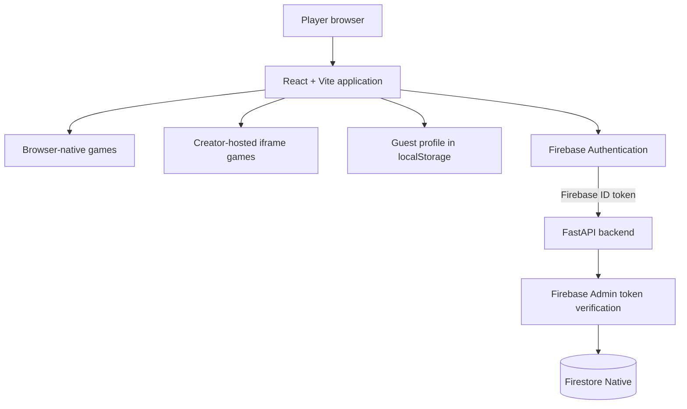

CloudPlay
CloudPlay is an instant-play browser gaming portal built with React, Vite and browser game technologies. It brings together browser-native games, selected creator-hosted iframe games, and a local-first player progression experience.
[!IMPORTANT]
CloudPlay is not currently an AAA cloud game streaming service. Most games execute in the player's browser or are embedded from external creators. Remote GPU game streaming is a separate future research and cost-feasibility phase.

[!NOTE]
This README distinguishes the current codebase from the target architecture. A planned service or feature is not evidence that it has been implemented or deployed.

Table of contents
- Project vision
- Current technology stack
- Current implementation status
- Architecture
- Local development
- Docker development
- Selected GCP deployment architecture
- Cost safeguards
- Security principles
- Roadmap
- Learning objectives
- Detailed documentation
Project vision
CloudPlay aims to provide:
- Instant browser-based game discovery and play.
- A consistent dashboard, game-player experience and navigation.
- Guest play without mandatory registration.
- Local progression for guests, with optional account-based cloud sync.
- A backend API for authenticated profile operations.
- A cost-conscious GCP deployment that can evolve as real usage grows.
- A practical portfolio project for learning backend engineering, cloud infrastructure and DevOps.
Browser games versus cloud game streaming
These are different architectures:
Browser gaming (current direction)	Remote GPU game streaming (future research)
Game code/assets execute in the browser	Game executes on a remote GPU machine
Uses JavaScript, Canvas, Phaser, WebGL or iframe embeds	Uses GPU instances, encoding, streaming and low-latency networking
Hosting primarily delivers static assets and APIs	Infrastructure must continuously render and stream frames
Can be comparatively inexpensive	Can be expensive and requires capacity planning


Do not describe the current project as a GeForce NOW-style platform. GPU streaming is not part of the initial deployment.
Current technology stack
Layer	Technology	Purpose
Frontend	React 19, Vite 8	Application UI and build tooling
Styling	Tailwind CSS 4	Responsive styling
Routing	React Router	Client-side navigation
Browser games	Phaser, Three.js/WebGL, Canvas, Web Audio	Game rendering and interaction
State	React Context and local player store	UI and player progression
Backend	Python 3.12, FastAPI, Uvicorn, Pydantic	HTTP API and validation
Identity	Firebase Authentication	Email/password identity
Token verification	Firebase Admin SDK	Verify Firebase ID tokens in the API
Document database	Firestore Native	Planned cloud player profile persistence
Local orchestration	Docker, Docker Compose, Nginx	Local containerized environment
Source control	Git and GitHub	Version control and collaboration


Technology presence does not imply every integration is complete. See Current implementation status and the detailed blueprint.
Current implementation status
Present in the codebase or previously verified during development
- React/Vite browser gaming interface and game catalogue.
- Shared game-player experience and navigation.
- Browser games including Cyber 2048, Hill Climb-style gameplay, Ludo, Asteroid Fury and Block Drop.
- Selected creator-hosted browser games embedded through iframes.
- Guest profile/progression stored in browser localStorage.
- Firebase email/password authentication UI and client helpers.
- FastAPI API skeleton and Firestore client initialization.
- Firebase ID-token verification dependency.
- Token-protected profile-sync route.
- Frontend API helper capable of attaching a Firebase ID token.
- Dockerfiles for frontend/backend and Docker Compose/Nginx configuration.
Known integration gaps to close before production
- PlayerContext does not yet complete the end-to-end cloud profile sync lifecycle.
- Signup/profile bootstrap must create Firestore documents using the verified Firebase UID.
- Existing registration and profile-sync behavior must be reconciled around one canonical users/{uid} document.
- Guest-to-account migration and cross-device profile restore need implementation and tests.
- Backend profile schema must match the frontend player store.
- Public user-list and registration routes need review and restriction.
- CORS must be limited to trusted production origins.
- Health checks should not write test documents in production.
- Production hosting rewrites, Cloud Run configuration, CI/CD and monitoring are not yet evidenced as deployed.
Deployment status: No production CloudPlay deployment is claimed by this README. The selected GCP architecture below is a plan.
Architecture
Current local-first application flow

Selected target GCP architecture
The selected initial deployment direction is Option B: near-free full-stack GCP.
```mermaid
flowchart TB
    Browser[Player browser]
    Hosting[Firebase Hosting<br/>React static build]
    Auth[Firebase Authentication]
    Run[Cloud Run<br/>FastAPI container]
    Verify[Firebase Admin<br/>ID-token verification]
    Store[(Firestore Native<br/>users/{uid})]
    Registry[Artifact Registry]
    Logs[Cloud Logging]
    Monitor[Cloud Monitoring]

    Browser --> Hosting
    Browser --> Auth
    Browser -->|HTTPS + Bearer ID token| Run
    Run --> Verify
    Verify --> Run
    Run -->|UID-scoped reads/writes| Store
    Registry -->|Container image| Run
    Run --> Logs
    Run --> Monitor
```
Planned request lifecycle:
1. Firebase Hosting serves the React application.
2. Guests play without signing in; guest progress remains in localStorage.
3. Registered players authenticate through Firebase Authentication.
4. The frontend obtains a Firebase ID token.
5. The frontend sends the token to FastAPI in the Authorization: Bearer header.
6. FastAPI verifies the token using Firebase Admin SDK.
7. The backend derives the UID from the verified token and accesses users/{uid} in Firestore.
8. The frontend restores or synchronizes profile state while preserving local data if the network is unavailable.
A Firebase Hosting rewrite to Cloud Run may be used to expose /api/* through the Hosting domain, subject to configuration and service compatibility checks. If the API uses a separate origin, configure exact trusted CORS origins.
Proposed service responsibilities
Service	Planned responsibility
Firebase Hosting	Serve the React/Vite static frontend over HTTPS
Firebase Authentication	Manage user identity and issue ID tokens
Cloud Run	Run the stateless FastAPI backend
Firestore Native	Store UID-keyed player profiles and progression
Artifact Registry	Store versioned backend container images
Cloud Logging	Application/request logs
Cloud Monitoring	Metrics, dashboards and alerts
IAM	Least-privilege service access


Target region: asia-south1 (Mumbai), subject to service availability and current regional pricing.
Local development
Prerequisites
Install and verify:
- Git
- Node.js and npm (use the versions supported by the frontend lockfile)
- Python 3.12
- Docker Desktop and Docker Compose (for container work)
- Google Cloud CLI only if you need local ADC access to the existing Firestore project
Do not install or upgrade dependencies blindly. Check the repository lockfiles and package scripts first.
Frontend
cd frontend
npm ci
npm run dev
Vite normally serves the frontend at:
http://localhost:5173
Backend
cd backend
python -m venv venv
.\venv\Scripts\Activate.ps1
pip install -r requirements.txt
python -m uvicorn app.main:app --reload
The API normally serves at:
http://localhost:8000
FastAPI's interactive OpenAPI documentation is normally available at:
http://localhost:8000/docs
The backend's Firestore integration may require Google Application Default Credentials (ADC) and appropriate IAM permissions for the configured project. Never commit ADC files, access tokens or service-account private keys.
Frontend checks
cd frontend
npm run build
npm test
npm run lint
Check frontend/package.json for the actual scripts available in the current checkout. Test and lint scripts may change as the project evolves.
Docker development
The repository includes frontend/backend Dockerfiles and a root docker-compose.yml.

Before running Compose:
1. Inspect the Compose file and confirm service names, ports and image tags.
2. Confirm the ADC mount path exists if local Firestore access is required.
3. Ensure credentials are mounted at runtime rather than copied into images.
4. Build images again after changing application source.
5. Test frontend routes, API proxying and backend health separately.
Useful commands:
docker compose config
docker compose build
docker compose up -d
docker compose ps
docker compose logs -f
docker compose down
depends_on controls startup ordering; it does not guarantee that a dependency is ready to accept requests. Use health checks and application retry logic where appropriate.
Selected GCP deployment architecture
Initial deployment configuration proposal
These are proposed starting values for later testing, not deployed settings or guaranteed cost-optimal values.
Setting	Initial proposal
GCP project	cloudplay-513308
Region	asia-south1 (Mumbai)
Frontend	Firebase Hosting
Identity	Firebase Authentication
Backend	FastAPI on Cloud Run
Database	Firestore Native
Cloud Run CPU	1 vCPU
Cloud Run memory	512 MiB
Billing model	Request-based
Minimum instances	0 (scale-to-zero)
Maximum instances	1 initially
Concurrency	Start around 40; benchmark before tuning
GPU	None
Background workers	None initially


The application should use a dedicated Cloud Run runtime service account and Application Default Credentials through the attached service identity. Do not package local ADC credentials or service-account JSON keys into the container.
Firestore profile model
The initial canonical profile path is:
users/{firebase_uid}
Proposed fields (must be reconciled with the real frontend store and backend Pydantic models before implementation):
Field	Type	Purpose
username	string	Display name
email	string	User email, where needed
avatarId	string	Selected avatar
xp	integer	Experience points
coins	integer	In-game currency
totalPlays	integer	Total game plays
playtimeSeconds	integer	Accumulated playtime
highScores	map	Per-game high scores
favourites	array	Favourite game IDs
achievements	array/map	Unlocked achievements
recentlyPlayed	array	Bounded recent-game history
createdAt	timestamp	Profile creation time
updatedAt	timestamp	Last accepted update
schemaVersion	integer	Profile migration version


The backend must derive the document UID from the verified Firebase token. It must not trust a client-provided UID as authorization. XP, coins, achievements and competitive scores should be server-authoritative or validated server-side.
Cost safeguards
Near-free does not mean guaranteed ₹0. Cloud Run requires a Google Cloud billing account linked to the project. Firebase Spark does not allow deployment of paid Google Cloud services such as Cloud Run. A later Cloud Run deployment therefore requires a billing-plan change and a linked billing account.
[!CAUTION]
Billing is currently disabled and must remain disabled until explicit approval. No billing account linkage, payment method, paid resource creation or deployment is authorized by this README.

Initial learning budget target: ₹0–₹500/month. This is a target, not a hard spending cap or guaranteed invoice.
Cost-control checklist
- [ ] Keep billing disabled until the owner explicitly approves the billing change.
- [ ] Prepare a current itemized estimate before enabling billing.
- [ ] Verify regional prices, free-tier eligibility, taxes and quotas before deployment.
- [ ] Configure Cloud Run minimum instances to zero.
- [ ] Start with a conservative maximum instance count and request timeout.
- [ ] Use request-based billing and measure concurrency.
- [ ] Avoid GKE, Cloud SQL, GPUs, Memorystore, always-on VMs and unnecessary networking in the initial deployment.
- [ ] Use one free-tier-eligible Firestore database initially.
- [ ] Avoid per-frame/per-keystroke writes and unbounded queries.
- [ ] Optimize static assets and cache immutable frontend files.
- [ ] Prune unused Artifact Registry images.
- [ ] Review Cloud Logging ingestion and retention.
- [ ] Monitor actual costs by SKU after any approved deployment.
- [ ] Maintain a tested shutdown and cleanup runbook.
Budget alerts are not spending caps. A Cloud Billing budget alert does not automatically stop services at the selected amount. Cloud Run maximum instances also does not cap every other billable service, such as Firestore, Hosting egress, registry storage, logging or networking.
Deployment approval gates
Deployment must wait until:
1. UID-keyed profile bootstrap and authenticated profile operations are complete.
2. PlayerContext supports auth state, guest migration and cloud restore.
3. Public user-list and registration endpoints are removed or appropriately restricted.
4. Backend and frontend profile schemas are aligned.
5. CORS is restricted and production health checks are read-only.
6. Automated tests and Docker builds pass.
7. Hosting rewrites and Cloud Run configuration are prepared and reviewed.
8. Current pricing and an itemized cost estimate are reviewed.
9. IAM, runtime service identity, secrets, logging and rollback are reviewed.
10. The owner explicitly approves billing linkage.
11. The owner separately approves deployment.
Security principles
- Never commit .env.local, ADC files, service-account keys or access tokens.
- Never send Firebase ID tokens in screenshots, logs or GitHub issues.
- Verify Firebase ID tokens on protected backend routes.
- Derive the user UID from the verified token, not from a request body.
- Do not expose unrestricted user-list endpoints.
- Treat browser localStorage as user-controlled and potentially tampered data.
- Do not trust client-supplied XP, coins or achievements for competitive rewards.
- Use least-privilege IAM for Cloud Run's runtime identity.
- Restrict CORS to trusted origins.
- Use HTTPS for production traffic.
- Validate request sizes, field types, numeric ranges and update frequency.
- Avoid write-based health checks in production.
Roadmap
Stage	Work	Deployment/cost policy
1	Complete guest defaults and safe localStorage migration	Local
2	Implement UID-keyed Firestore profile bootstrap and /api/me/profile	Local/emulator or existing approved access
3	Integrate Firebase auth state with PlayerContext	Local
4	Implement guest-to-account migration and cross-device restore	Local
5	Add backend validation, tests and route/service separation	Local
6	Harden Docker Compose and add CI checks	Local/GitHub Actions
7	Prepare Firebase Hosting + Cloud Run configuration and cost estimate	No deployment
8	Obtain approval, then enable billing and deploy in a controlled manner	Explicit approval required
9	Learn Terraform, Linux/VMs, PostgreSQL/Cloud SQL and Kubernetes/GKE through separate labs	Local-first; cloud labs require separate cost approval
10	Research multiplayer and remote GPU streaming separately	Separate feasibility and cost approval


Separate GCP / DevOps learning track
These technologies are important learning goals, but they are not part of the initial near-free production architecture:
- Terraform: learn providers, resources, variables, outputs, state, modules, plans and safe destroy workflows. Start with local exercises and plan-only review.
- Compute Engine / Linux VMs: learn Linux administration, SSH, permissions, systemd, Nginx, firewall rules and Docker. Start locally; use a temporary VM only after approval.
- Cloud SQL: learn PostgreSQL, schema design, indexes, migrations, backups, connection pooling and private connectivity. Start with local PostgreSQL.
- Kubernetes: learn Pods, Deployments, Services, ConfigMaps, Secrets, probes, resource requests/limits and Helm using Minikube or kind.
- GKE: later learn cluster architecture, node pools, Autopilot versus Standard, Workload Identity, upgrades, autoscaling and ingress. Create a cloud cluster only after a cost review and explicit approval.
- Observability: learn Prometheus and Grafana locally, then Cloud Monitoring and Cloud Logging.
Detailed documentation
The full engineering blueprint is the source of truth for the deeper project explanation:
- [CloudPlay Engineering Blueprint & Interview Handbook](docs/CLOUDPLAY_BLUEPRINT.md)
It includes:
- Project vision and architecture diagrams.
- Current source-code audit and file-by-file responsibilities.
- Authentication and Firestore data design.
- Docker and local deployment concepts.
- Selected GCP deployment architecture and cost safeguards.
- Browser gaming versus AAA GPU streaming.
- Phased implementation and DevOps learning roadmap.
- Security, testing and troubleshooting guidance.
- Interview questions and answer frameworks.
Project status and contribution discipline
CloudPlay is an evolving learning and portfolio project. Keep documentation honest:
- Mark a feature implemented only after it exists and has been tested.
- Mark a feature planned if it is only an architecture or roadmap decision.
- Do not claim production deployment, GKE, Cloud SQL, Terraform provisioning or GPU streaming unless it has actually been completed and verified.
- Update this README and the detailed blueprint whenever architecture or implementation changes.
- Never commit credentials, tokens, private keys or production secrets.
