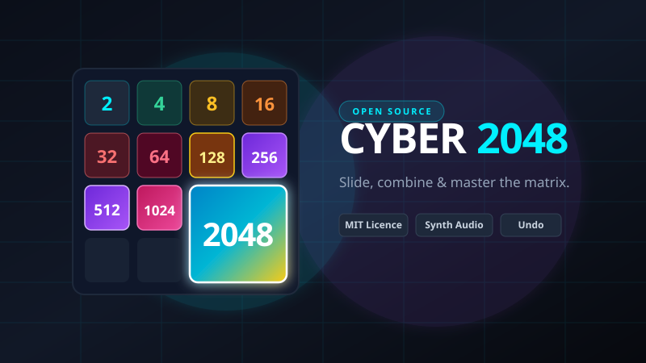

# CloudPlay — Browser Gaming Platform

CloudPlay is a modern, high-performance browser gaming platform built with React, Vite, Tailwind CSS, Phaser, and Web Audio. It combines the rapid instant-play experience of portals like CrazyGames and Poki with the visual fidelity, responsive UI, and progression depth of a desktop gaming library like Steam.



---

## Highlights

- **Cyber 2048**: Rebuilt edition of the famous open-source puzzle game by Gabriele Cirulli (MIT License), featuring cyberpunk neon aesthetics, Web Audio procedural synth feedback, multi-grid dimensions (3x3 Blitz, 4x4 Classic, 5x5 Expanded), undo history, touch swipe support, and CloudPlay progression integration.
- **Instant Local & Embedded Play**: No downloads or installs required. Local games run directly inside React and canvas/Phaser engines; curated open-source titles run inside a sandboxed in-app player.
- **Phaser 3 Game Integrations**: Features original arcade and puzzle games powered by the Phaser game engine with procedural rendering and particle systems.
- **Frictionless Player Profile System**: No forced authentication or registration. First-time visitors choose a name and avatar; progression, XP, coins, achievements, and play history persist automatically in `localStorage`.
- **Mobile Gyroscope & Touch Control System**: Tilt-to-steer motion controls (DeviceOrientation API) with deadband calibration and iOS permission support in Temple Run & Hill Climb Racing, plus responsive on-screen touch D-Pads and swipe gestures.
- **Mobile-First Responsive Shell**: Native-feel bottom navigation bar for mobile devices (`< 768px`) with quick tabs (Home, Explore, Library, Trophies, Profile), safe-area insets, and auto-collapsing game player headers.
- **Game Economy & Rewards**: True gameplay-triggered progression. Gain XP, level up, unlock achievement badges, and track playtime.
- **Responsive Gaming Dashboard**: Dark aesthetic with deep charcoal/navy backgrounds, purple & cyan neon accents, smooth animations, and optimized layouts for desktop (1920px), laptop (1366px), tablet, and mobile (390px/320px).

---

## Featured Game: Cyber 2048 (Open Source)

**Cyber 2048** is an enhanced, cybernetic edition of Gabriele Cirulli's classic open-source puzzle game.

- **Modes**:
  - **Classic 4x4**: The iconic 2048 target.
  - **Blitz 3x3**: Compact, high-pressure hardcore mode (target 1024).
  - **Expanded 5x5**: Massive strategic grid for high-score chasers (target 4096).
- **Features**:
  - Full undo history (up to 15 moves).
  - Procedural Web Audio API sound synthesis with ascending pitch chimes for merges.
  - High score tracking per grid size with `localStorage` persistence.
  - Dynamic victory celebration & game over state with XP/Coin rewards.
- **Controls**:
  - `Arrow Keys` or `W A S D` — Slide tiles
  - `Touch Swipe` — Slide tiles on mobile & tablet
  - `U` — Undo move
  - `R` — Reset / New Game

---

## Game Catalog

| Title | Category | Engine / Source | Mode | Attribution & Licence |
|---|---|---|---|---|
| **Cyber 2048** | Puzzle / Strategy | React + Web Audio | Local | [Gabriele Cirulli](https://github.com/gabrielecirulli/2048) · MIT |
| **HexGL** | 3D Sci-Fi Racing | Three.js / WebGL | Embed | [BKcore](https://github.com/BKcore/HexGL) · MIT |
| **MotoGP: Speed Trial** | 3D Motorcycle Racing | HTML5 / Box2D / Phaser | Embed | [Leonardo Russo](https://github.com/lrusso/MotoRacer) · MIT |
| **Clumsy Bird** | Arcade / Casual | MelonJS / Canvas | Embed | [Ellison Leão](https://github.com/ellisonleao/clumsy-bird) · MIT |
| **Particle Clicker** | Strategy / Clicker | HTML5 / JS | Embed | [CERN Team](https://github.com/particle-clicker/particle-clicker) · MIT |
| **Sandboxels** | Simulation / Physics | Canvas / Engine | Embed | [R74n](https://github.com/R74nCom/sandboxels) · GPL-3.0 |
| **A Dark Room** | Adventure / Text RPG | Minimalist HTML5 | Embed | [Doublespeak Games](https://github.com/doublespeakgames/adarkroom) · MPL-2.0 |
| **Astray** | Puzzle / 3D Maze | Three.js / Box2D | Embed | [wwwtyro](https://github.com/wwwtyro/Astray) · MIT |
| **DuckHunt JS** | Arcade / Retro | Canvas / Audio | Embed | [Matt Surabian](https://github.com/MattSurabian/DuckHunt-JS) · MIT |
| **SkiFree.js** | Arcade / Retro | HTML5 / JS | Embed | [Dan Hough](https://github.com/basicallydan/skifree.js) · MIT |
| **Hill Climb Racing** | Racing | 2D Physics Canvas | Local | CloudPlay Original |
| **Temple Run** | 3D Runner / Arcade | React + Canvas + Web Audio | Local | [GameHelix](https://github.com/GameHelix/temple_run) · MIT |
| **Trigger Rally 3D** | 3D Rally Racing | WebGL / Three.js | Embed | [CodeArtemis](https://github.com/CodeArtemis/TriggerRally) · GPL-2.0 |
| **OpenWorld 3D** | 3D Adventure | Three.js / Ammo.js | Embed | [obecerra3](https://github.com/obecerra3/OpenWorldJS) · MIT |
| **Asteroid Fury** | Arcade / Space | Phaser 3 | Local | CloudPlay Original (Phaser MIT) |
| **Block Drop** | Puzzle | Phaser 3 | Local | CloudPlay Original (Phaser MIT) |
| **Ludo Royale** | Board / Strategy | React + SVG | Local | CloudPlay Original · 2–4 Pass-and-Play |
| **Super Kart 3D** | Racing | Three.js / JS | Embed | [fecolinhares/super-kart-3djs](https://github.com/fecolinhares/super-kart-3djs) · MIT |
| **Grapple God: The Ascent** | Platformer | Phaser 3 | Embed | [ejrossma/GrappleGod](https://github.com/ejrossma/GrappleGod) · Independent |
| **Drift** | Racing | WebGL | Embed | [Makone](https://www.makone.dev/w/drift/) · MIT |
| **Snowdrift** | Simulation | WebGL | Embed | [Makone](https://www.makone.dev/w/snowdrift/) · MIT |
| **Swarm** | Action | WebGL | Embed | [Makone](https://www.makone.dev/w/swarm/) · MIT |

*Games curated from [michelpereira/awesome-open-source-games](https://github.com/michelpereira/awesome-open-source-games). For complete attribution, repository links, and licensing terms, see [GAME_SOURCES.md](./GAME_SOURCES.md).*

---

## Architecture Overview

```
cloud_play/
├── frontend/
│   ├── public/
│   │   └── game-covers/          # Original vector SVG artwork for every game
│   ├── src/
│   │   ├── components/           # Reusable UI (Layout, GameCard, Modals, Toasts)
│   │   ├── context/              # PlayerContext, usePlayer hook
│   │   ├── games/                # Local game engines & wrappers
│   │   │   ├── Cyber2048/        # Cyber 2048 (React, matrix math, Web Audio)
│   │   │   ├── AsteroidFury/     # Phaser 3 space survival shooter
│   │   │   ├── BlockPuzzle/      # Phaser 3 block-clearing puzzle
│   │   │   ├── HillClimb.jsx     # Trail Rush physics racer
│   │   │   └── Ludo.jsx          # Ludo Royale pass-and-play board game
│   │   ├── lib/
│   │   │   ├── api.js            # FastAPI client service with fallback
│   │   │   ├── catalog.js        # Game catalogue definitions, filters & search
│   │   │   └── playerStore.js    # Local player persistence, leveling, achievements
│   │   ├── pages/                # Home, Explore, Library, Achievements, Profile, GamePlayer
│   │   └── App.jsx               # React Router configuration
│   └── package.json
## Getting Started

### 1. Start the Frontend Application

```bash
cd frontend
npm install
npm run dev
```
*Visit `http://localhost:5173` in your browser. All games run directly inside the browser with zero external server dependencies!*

### 2. Run Tests and Lint

```bash
cd frontend
npm test      # Runs unit test suite (25/25 passing)
npm run lint  # Runs Oxlint (0 errors, 0 warnings across all files)
npm run build # Production Vite build
```

---

## Future Cloud Deployment Plan (Google Cloud Platform)

When moving from local development to production hosting, the recommended architecture is:

| Component | GCP Service | Configuration | Estimated Monthly Cost |
|---|---|---|---|
| **Multiplayer Game Server** | Google Cloud Run or GKE | 2 vCPU, 2 GB RAM, WebSocket session affinity | \$15 – \$25 / mo |
| **Frontend Static Hosting** | Firebase Hosting or Cloud Storage + CDN | Global edge caching | \$0 – \$5 / mo |
| **Global Load Balancer** | Cloud Load Balancing | HTTPS + WSS termination | \$18 / mo |
| **Total Estimated Cost** | — | — | **~\$35 – \$48 / month** |

*(Note: Currently runs 100% locally with zero cloud costs).*
